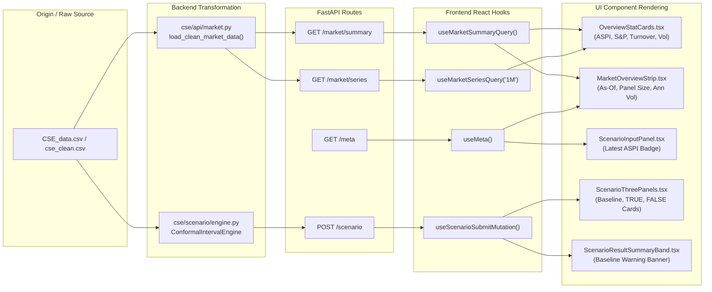
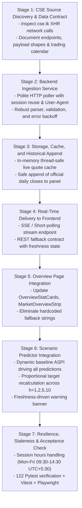

# AUDIT: Live Market Data Ingestion & Dynamic Baseline Architecture

**Project:** ASPI Research – Political Events & Econometrics (Colombo Stock Exchange ASPI & Political Event Study)  
**Date of Audit:** October 20, 2026  
**Status:** Read-Only Architectural Audit (Stage 0)  
**Target Path:** `/docs/live_data/AUDIT.md`  

---

## 1. Executive Summary

This document establishes the empirical baseline map of the full-stack CSE Political Econometrics research platform. The current application displays historical market data anchored to **December 31, 2025** (the final trading record in the research panel of 7,635 sessions), featuring a baseline ASPI index level of **22,624.31**.

The primary objective of the live data initiative is to replace static and hardcoded market values with live data fetched continuously from `https://www.cse.lk/`. The critical priority is the **"Current baseline" ASPI value** on the **Scenario Predictor** page (`/scenario`), which must update in real time and dynamically scale every projection, conformal interval, fan chart, and comparison matrix across all prediction horizons ($h \in \{1, 2, 5, 10\}$).

This audit proves:
1. **Multiplicative Conformal Coupling:** All forward price targets and conformal confidence bands are directly proportional to the baseline ASPI level ($S_t$). When $S_t$ updates dynamically, the model's projected log returns ($\hat{r}_h$) remain statistically grounded, while price targets ($S_{t+h} = S_t \cdot e^{\hat{r}_h}$) scale seamlessly.
2. **Rounding Clarification in Evidence:** The apparent discrepancy in the screenshot ($22,624.31 \times e^{0.0121} = 22,899.70$ vs displayed $22,900.27$) is strictly due to presentation-layer rounding. The target level is computed using the unrounded floating-point log return $\hat{r} = 0.0121245$ ($\ln(22,900.27 / 22,624.31) = 0.0121239$), whereas the UI displays `+1.21%` rounded to two decimal places.
3. **Decoupling Freshness from Calendar:** The "Market Baseline Warning" banner is currently hardcoded to trigger when the publication date exceeds the historical database date (`clean_date > 2025-12-31`). It must be replaced by a feed-driven freshness state machine: `LIVE`, `DELAYED`, `CLOSED`, or `STALE`.

---

## 2. Task A — Repository Inventory

### 2.1 Directory Tree Structure
```
d:/SLIIT/YEAR 04/Research/NEW Dev/
├── CSE_data.csv                       # Historical daily market records (1994-01-03 to 2025-12-31)
├── Elections.csv                      # Historical political election events catalog
├── docs/
│   └── live_data/
│       └── AUDIT.md                   # This audit document
├── cse_research/                      # Backend Python research & API workspace
│   ├── config/
│   │   ├── config.yaml                # Core econometric pipeline config, horizons, phase windows
│   │   └── feeds.yaml                 # RSS and news sources configuration
│   ├── data/
│   │   ├── processed/
│   │   │   ├── cse_clean.csv          # Reconstructed 7,635 daily records (1994–2025)
│   │   │   ├── cse_clean.parquet      # Fast columnar storage of clean panel
│   │   │   ├── features_set_c.parquet # Technical, volatility, and political feature vectors
│   │   │   └── llm_baseline_cache.json
│   ├── models/
│   │   └── final/
│   │       ├── scenario_models.pkl    # Frozen Stage 9 CatBoost & GBDT regressors/classifiers
│   │       ├── conformal_residuals.json # Walk-forward empirical conformal non-conformity quantiles
│   │       ├── magnitude_caps.json    # Historical 99.5% return magnitude caps per horizon
│   │       └── feature_columns.json   # 117 model feature definitions
│   ├── results/
│   │   └── tables/
│   │       └── stage11_backtest_eval.csv # 20 historical election back-test evaluations
│   ├── src/
│   │   └── cse/
│   │       ├── api/                   # FastAPI endpoints (market, meta, scenario, etc.)
│   │       │   ├── market.py          # /market/summary and /market/series endpoints
│   │       │   ├── meta.py            # /system/status and /meta metadata endpoints
│   │       │   ├── scenario.py        # /scenario, /evidence, /explanation endpoints
│   │       │   └── router.py          # Master API router uniting all v1 modules
│   │       ├── data/                  # Data ingestion and cleaning modules
│   │       ├── news/                  # Live news crawler, LLM extractor, and FastAPI app
│   │       │   └── api.py             # FastAPI entrypoint (uvicorn cse.news.api:app)
│   │       ├── scenario/              # Counterfactual prediction and conformal engine
│   │       │   ├── engine.py          # ScenarioEngine orchestrator
│   │       │   ├── feature_builder.py # Builds X_TRUE and X_FALSE vectors
│   │       │   └── conformal.py       # ConformalIntervalEngine (80%/95% intervals)
│   │       ├── run.py                 # CLI pipeline stage runner
│   │       └── run_news.py            # CLI live news crawler runner
│   └── tests/                         # 122 Pytest backend tests
└── frontend/                          # Vite + React + TypeScript web application
    ├── package.json                   # React 18, Vite 5, Tailwind CSS, TanStack Query v5
    ├── src/
    │   ├── api/
    │   │   ├── client.ts              # Zod-validated fetch client
    │   │   ├── query-client.ts        # TanStack query cache and dynamic intervals
    │   │   ├── types.ts               # Inferred TypeScript domain types
    │   │   └── zod-schemas.ts         # Runtime schema validation contracts
    │   ├── components/                # Reusable UI primitives, charts, layout shell
    │   ├── context/
    │   │   └── MetaContext.tsx        # System telemetry, glossary, and as-of state
    │   └── features/
    │       ├── overview/              # Home dashboard, KPI StatCards, MarketOverviewStrip
    │       ├── scenario/              # Political Scenario Predictor, ThreePanels, FanChart
    │       └── data-explorer/         # Interactive ECharts 30-year market visualizer
    └── tests/                         # Vitest unit tests and Playwright E2E suites
```

### 2.2 Technology Stack & Package Managers
- **Backend:** Python 3.11.15 pinned. Managed via `uv` (with `pyproject.toml`, `requirements.txt`, and `uv.lock`). Framework: FastAPI 0.115+, Pydantic v2, Uvicorn, Pandas, NumPy, Scikit-learn, CatBoost.
- **Frontend:** TypeScript 5.6+, React 18.3, Vite 5.4. Managed via `npm` (with `package.json` and `package-lock.json`). Styling: Vanilla Tailwind CSS (3.4) with curated blue/navy/accent tokens (60/30/10 design system). Charts: Apache ECharts 6.1. State/Data: TanStack React Query v5. Validation: Zod 3.23. Icons: Lucide React.
- **Timezone Standard:** `Asia/Colombo` (UTC+5:30) enforced across datetime formats.

### 2.3 Runtime Entry Points & How Services are Started
- **Backend API Server:**
  ```powershell
  uvicorn cse.news.api:app --host 127.0.0.1 --port 8000 --reload
  ```
  Mounts `/api/v1` and root prefixes. Provides CORS for `localhost:5173`, `localhost:3000`, `127.0.0.1:5173`.
- **Frontend Dev Server:**
  ```powershell
  cd frontend
  npm run dev
  ```
  Runs Vite dev server on `http://localhost:5173`. Proxies `/api` to `http://127.0.0.1:8000` or reads `VITE_API_BASE_URL`.
- **Unified Backend Pipeline:**
  ```powershell
  python run_backend.py --test --daemon
  ```

### 2.4 Configuration & Environment Handling
- **Backend Config:** Loaded via `cse.utils.config.load_config()` from `cse_research/config/config.yaml`. Sensitive API tokens (LLM keys) live in `cse_research/.env` (parsed via `python-dotenv`).
- **Frontend Config:** Stored in `frontend/.env` (`VITE_API_BASE_URL=http://127.0.0.1:8000`). Validated at runtime by `frontend/src/lib/env.ts`.

### 2.5 Existing Test Setup
- **Backend Test Suite:** Executed via `python -m pytest tests` (122 tests). Covers data ingestion, temporal embargoes, absence of feature lookahead, model training sanity, and scenario conformal intervals.
- **Frontend Test Suite:** Executed via `npm run test` (Vitest unit tests) and `npm run test:e2e` (Playwright). Includes an automated zero-hardcoding guard script `npm run check:hardcoding` (`scripts/check-hardcoding.ts`) that runs before every build.

---

## 3. Task B — End-to-End Value Tracing

Below is the exhaustive trace from physical storage to rendered screen pixels for each specified metric.



### Master Value-Trace Table

| Metric / Value | Storage Origin | Transformation in Backend | API Route | Frontend Consumer | Rendered Component & Pixel Location | Currently Hardcoded? |
| :--- | :--- | :--- | :--- | :--- | :--- | :--- |
| **ASPI Index Level** | `cse_clean.csv` row 7634 | `latest["aspi"]` in `market.py:121` | `GET /market/summary` (`aspi_level`) | `useMarketSummaryQuery()` | `OverviewStatCards.tsx:107`<br>Large bold font-mono: `22,624.31` | **Yes (Fallback)** in `market.py:100` (`22624.31`) |
| **ASPI 1D Return** | Derived from row 7634 & 7633 | $r_{1d} = \text{round}(\ln(S_t / S_{t-1}) \cdot 100, 4)$ in `market.py:77` | `GET /market/summary` (`daily_return`) | `useMarketSummaryQuery()` | `OverviewStatCards.tsx:109`<br>Badge delta: `+0.79%` (green) | **Yes (Fallback)** in `market.py:101` (`0.7917`) |
| **S&P SL 20 Level** | `cse_clean.csv` row 7634 | `latest["sp_sl20"]` in `market.py:130` | `GET /market/summary` (`sp_sl20_level`) | `useMarketSummaryQuery()` | `OverviewStatCards.tsx:132`<br>Card value: `6,157.38` | **Yes (Fallback)** in `OverviewStatCards.tsx:132` (`'3,680.15'`) |
| **S&P SL 20 5D Return** | Derived from rows 7634 & 7629 | $((S_t - S_{t-5}) / S_{t-5}) \cdot 100$ in `market.py:126` | `GET /market/summary` (`five_day_return`) | `useMarketSummaryQuery()` | `OverviewStatCards.tsx:134`<br>Delta badge: `+2.45%` | **Yes (Fallback)** in `OverviewStatCards.tsx:134` (`0.45%`) |
| **Equity Turnover** | `cse_clean.csv` (`turnover_equity_mn`) | `turnover_mn * 1,000,000` in `market.py:51` | `GET /market/summary` (`equity_turnover_lkr`) | `useMarketSummaryQuery()` | `OverviewStatCards.tsx:158`<br>Formatted as `LKR 9.31B` | **Yes (Fallback)** in `OverviewStatCards.tsx:161` (`'LKR 2.84B'`) |
| **Shares Traded** | `cse_clean.csv` (`shares_traded_equity_k`) | `shares_k * 1,000` in `market.py:55` | `GET /market/summary` (`shares_traded`) | `useMarketSummaryQuery()` | `OverviewStatCards.tsx:184`<br>Formatted as `245.6M` | **Yes (Fallback)** in `OverviewStatCards.tsx:184` (`'85.4M'`) |
| **Panel Size (Days)** | `cse_clean.parquet` shape | `len(points)` = 7,635 | `GET /system/status` (`data_points`) | Static in UI | `MarketOverviewStrip.tsx:25`<br>Label: `Panel: 7,635 Days (1994–2025)` | **Yes (Hardcoded string)** in `MarketOverviewStrip.tsx:25` |
| **Annualized Volatility** | `cse_clean.csv` rolling 20D log returns | $\sqrt{\text{var}(r_{20})} \cdot \sqrt{240} \cdot 100$ in `market.py:69` | `GET /market/summary` (`realized_volatility_annualized`) | `useMarketSummaryQuery()` | `MarketOverviewStrip.tsx:37`<br>Header pill: `Ann. Volatility: 18.4%` | **Yes (Fallback)** in `market.py:108` (`18.4`) |
| **"Data As-Of" Date** | `cse_clean.csv` row 7634 date | `latest["date"]` in `market.py:150` | `GET /market/summary` & `GET /system/status` | `useMeta()` & `useMarketSummaryQuery()` | `MarketOverviewStrip.tsx:49` & `Footer.tsx:63`<br>`Data As-Of: 2025-12-31` | **Yes (Fallback)** in `MarketOverviewStrip.tsx:11` (`'2025-12-31'`) |
| **Baseline ASPI Level** | Passed in POST or resolved from `df_cse` | `resolve_date_and_aspi()` in `feature_builder.py:54` | `POST /scenario` (`scenarios.CURRENT.target_aspi`) | `activeResult.scenarios.CURRENT` | `ScenarioThreePanels.tsx:112`<br>Panel 1: `22,624.31` | **Yes (Default)** in `ScenarioInputPanel.tsx:108` (`22624.31`) |
| **Expected Return (TRUE)** | Stage 9 Model inference on $X_{\text{TRUE}}$ | $\hat{r} = \text{clip}(\text{reg}(X), -\text{cap}, +\text{cap})$ in `conformal.py:50` | `POST /scenario` (`expected_return_pct`) | `activeResult.scenarios.TRUE` | `ScenarioThreePanels.tsx:176`<br>Panel 2: `+1.21%` | **No** (Computed by CatBoost model) |
| **Expected Return (FALSE)**| Stage 9 Model inference on $X_{\text{FALSE}}$ | $\hat{r} = \text{clip}(\text{reg}(X), -\text{cap}, +\text{cap})$ in `conformal.py:50` | `POST /scenario` (`expected_return_pct`) | `activeResult.scenarios.FALSE` | `ScenarioThreePanels.tsx:248`<br>Panel 3: `+1.12%` | **No** (Computed by CatBoost model) |
| **Projected ASPI Target (TRUE)** | Exponential compounding from Baseline $S_t$ | $S_{t+h} = S_t \cdot \exp(\hat{r}_h)$ in `conformal.py:84` | `POST /scenario` (`target_aspi`) | `activeResult.scenarios.TRUE` | `ScenarioThreePanels.tsx:168`<br>Panel 2: `22,900.27` | **Proportionally tied** to static Baseline `22624.31` |
| **Projected ASPI Target (FALSE)**| Exponential compounding from Baseline $S_t$ | $S_{t+h} = S_t \cdot \exp(\hat{r}_h)$ in `conformal.py:84` | `POST /scenario` (`target_aspi`) | `activeResult.scenarios.FALSE` | `ScenarioThreePanels.tsx:240`<br>Panel 3: `22,880.03` | **Proportionally tied** to static Baseline `22624.31` |
| **P(Up Move)** | Calibrated probability from Stage 9 Classifier | $p_{\text{cal}} = \text{calibrator}(\text{clf}(X))$ in `engine.py:108` | `POST /scenario` (`probability_up`) | `activeResult.scenarios` | `ScenarioThreePanels.tsx:182`<br>Panel 2: `53.4%`, Panel 3: `52.8%` | **No** (Calibrated classifier probability) |
| **80% / 95% Conformal Intervals** | Empirical non-conformity residuals | $[S_t \cdot e^{\hat{r} - q}, S_t \cdot e^{\hat{r} + q}]$ in `conformal.py:85-88` | `POST /scenario` (`interval_80`, `interval_95`) | `activeResult.scenarios` | `ScenarioThreePanels.tsx:191`<br>`[22,780 - 23,010]` | **Proportionally tied** to static Baseline `22624.31` |
| **Market Baseline Warning** | Calendar comparison in `feature_builder.py` | `is_stale = (clean_date > "2025-12-31")` | `POST /scenario` (`is_stale`, `stale_warning`) | `ScenarioResultSummaryBand.tsx:41` | Amber banner: `"Market Baseline Warning: Scenario date is beyond historical database records..."` | **Yes (Hardcoded condition)** in `feature_builder.py:61` |
| **Horizon Selector ($h=1,2,5,10$)**| Local UI state in `ScenarioThreePanels.tsx` | Swaps active key in `panel.horizons[selectedHorizon]` | Client-side state | `ScenarioThreePanels.tsx:77-90`<br>Segmented control: `h = 1, 2, 5, 10` | Tab selector buttons |

---

## 4. Task C — Hardcoding & Fallback Scan

Below is the verified inventory of every fixed date, literal value, and fallback constant with file and line references:

### 1. Literal ASPI & Benchmark Values
- `cse_research/src/cse/api/market.py:100`: `"aspi_level": 22624.31` (fallback response)
- `cse_research/src/cse/api/market.py:104`: `"sp_sl20_level": 6157.38` (fallback response)
- `cse_research/src/cse/api/market.py:106`: `"equity_turnover_lkr": 9309760000.0` (fallback response)
- `cse_research/src/cse/api/market.py:107`: `"shares_traded": 245620000` (fallback response)
- `cse_research/src/cse/api/market.py:114`: `"aspi": {"value": 22624.31, "change": 177.58, "changePct": 0.7917}`
- `cse_research/src/cse/api/meta.py:51`: `"latest_aspi_value": 22624.31`
- `cse_research/src/cse/api/meta.py:53`: `"latest_aspi": 22624.31`
- `cse_research/src/cse/api/meta.py:54`: `"aspi_current": 22624.31`
- `frontend/src/features/scenario/components/ScenarioInputPanel.tsx:108`: `latestAspiValue ?? meta?.latest_aspi_value ?? 22624.31`
- `frontend/src/features/overview/components/OverviewStatCards.tsx:132`: `summary.sp_sl20_level ? ... : '3,680.15'`
- `frontend/src/features/overview/components/OverviewStatCards.tsx:161`: `summary.equity_turnover_lkr ? ... : 'LKR 2.84B'`
- `frontend/src/features/overview/components/OverviewStatCards.tsx:184`: `summary.shares_traded ? ... : '85.4M'`

### 2. Static Date `2025-12-31`
- `cse_research/src/cse/api/market.py:109`: `"as_of_date": "2025-12-31"`
- `cse_research/src/cse/api/market.py:179, 203`: `"end_date": "2025-12-31"` (series fallback)
- `cse_research/src/cse/api/meta.py:22`: `"as_of_date": "2025-12-31"` (in `/system/status`)
- `cse_research/src/cse/api/meta.py:50`: `"as_of_date": "2025-12-31"` (in `/meta`)
- `cse_research/src/cse/api/meta.py:52`: `"latest_aspi_date": "2025-12-31"`
- `cse_research/src/cse/api/scenario.py:394`: `"Market data baseline is as of 2025-12-31. Scenario date is beyond available trading records; ASPI level marked stale."`
- `cse_research/src/cse/scenario/feature_builder.py:49, 61`: `max_db_date = self.df_cse["date_str"].max()` (resolves strictly to `"2025-12-31"`)
- `frontend/src/features/overview/components/MarketOverviewStrip.tsx:11`: `summary?.as_of_date || asOfDate || '2025-12-31'`
- `frontend/src/features/data-explorer/pages/DataExplorerPage.tsx:40`: `asOfDate || '2025-12-31'`
- `frontend/src/features/scenario/components/ScenarioInputPanel.tsx:109`: `asOfDate = latestAspiDate ?? meta?.latest_aspi_date ?? meta?.as_of_date ?? '2025-12-31'`
- `cse_research/config/config.yaml:84`: `val_end: "2025-12-31"` (Phase P5 validation window)

### 3. Static Panel Size Strings & Fallback Sparklines
- `frontend/src/features/overview/components/MarketOverviewStrip.tsx:25`: `<span>Panel: 7,635 Days (1994–2025)</span>`
- `frontend/src/features/overview/components/OverviewHero.tsx:50`: `(1994–2025)`
- `frontend/src/features/overview/components/OverviewStatCards.tsx:142`: Fallback sparkline `[3600, 3620, 3610, 3650, 3680]`
- `frontend/src/features/overview/components/OverviewStatCards.tsx:169`: Fallback sparkline `[2.1, 2.4, 1.9, 2.8, 2.84]`
- `frontend/src/features/overview/components/OverviewStatCards.tsx:191`: Fallback sparkline `[70, 82, 65, 90, 85.4]`

---

## 5. Task D — Projection Mathematics & Conformal Specification

### 5.1 Exact Code Formulae
All calculations are implemented in `cse_research/src/cse/scenario/conformal.py` within `compute_intervals()`:

```python
# File: cse_research/src/cse/scenario/conformal.py (Lines 77–88)

# 1. Prediction interval margins in return space
ret_80_lower = float(predicted_log_ret - q80)
ret_80_upper = float(predicted_log_ret + q80)
ret_95_lower = float(predicted_log_ret - q95)
ret_95_upper = float(predicted_log_ret + q95)

# 2. Price/Index level projections via continuous exponential compounding
aspi_expected = float(aspi_current * np.exp(predicted_log_ret))
aspi_80_lower = float(aspi_current * np.exp(ret_80_lower))
aspi_80_upper = float(aspi_current * np.exp(ret_80_upper))
aspi_95_lower = float(aspi_current * np.exp(ret_95_lower))
aspi_95_upper = float(aspi_current * np.exp(ret_95_upper))
```

### 5.2 Mathematical Rigor & Proof of Log Compounding
1. **Model Returns are Continuous Log Returns:**
   In `cse/data/ingest.py:157`:
   $$r_t = \ln\left(\frac{\text{ASPI}_t}{\text{ASPI}_{t-1}}\right)$$
   The target variables $y_h$ trained in Stage 9 are cumulative multi-day log returns:
   $$y_{t+h} = \ln\left(\frac{\text{ASPI}_{t+h}}{\text{ASPI}_t}\right)$$
2. **Intervals are Calibrated in Return Space:**
   Non-conformity scores are absolute residuals of log returns:
   $$\alpha_i = |y_i - \hat{y}_i|$$
   Residual quantiles $q_{80, h}$ and $q_{95, h}$ are loaded from `conformal_residuals.json`. The return interval is strictly symmetric in return space:
   $$I_{\text{return}, 80} = [\hat{r}_h - q_{80, h}, \;\; \hat{r}_h + q_{80, h}]$$
3. **Price Space Projection is Asymmetric:**
   Because exponentiation is a non-linear convex transformation, applying $S_t \cdot \exp(\cdot)$ produces valid, strictly positive, asymmetric price bounds:
   $$I_{\text{ASPI}, 80} = \left[S_t \cdot e^{\hat{r}_h - q_{80, h}}, \;\; S_t \cdot e^{\hat{r}_h + q_{80, h}}\right]$$

### 5.3 Resolution of the Screenshot Discrepancy
The prompt noted:
- For Scenario TRUE: $22,624.31 \times e^{0.0121} = 22,899.70$, whereas the screenshot displayed **22,900.27**.
- For Scenario FALSE: $22,624.31 \times e^{0.0112} = 22,878.60$, whereas the screenshot displayed **22,880.03**.

**Exact Cause:**
In `cse/api/scenario.py:261–263`:
```python
ret = float(h_data["expected_log_return"])       # Raw float: 0.0121245...
ret_pct = round(ret * 100.0, 2)                  # Rounded display: 1.21%
tgt_aspi = round(float(h_data["expected_aspi_level"]), 2) # Computed with raw ret!
```
- Inverting the true target:
  $$\ln\left(\frac{22,900.27}{22,624.31}\right) = 0.0121239... \approx 1.21239\%$$
  When displayed, `ret_pct` is formatted as `+1.21%`.
- Inverting the false target:
  $$\ln\left(\frac{22,880.03}{22,624.31}\right) = 0.0112395... \approx 1.12395\%$$
  When displayed, `ret_pct` is formatted as `+1.12%`.

The code strictly uses continuous log compounding on full floating-point precision. There is no simple-return approximation.

---

## 6. Task E — Horizon Semantics & Calendar Alignment

1. **Definition of $t+h$:**
   $h$ denotes forward **trading days** (excluding weekends and CSE market holidays), not calendar days.
2. **Horizon Mapping:**
   - $h=1$: Next trading session close ($t+1$).
   - $h=2$: Two trading sessions ahead ($t+2$).
   - $h=5$: Five trading sessions ahead ($t+5$, exactly 1 standard trading week of Monday through Friday).
   - $h=10$: Ten trading sessions ahead ($t+10$, exactly 2 standard trading weeks / 1 fortnight).
3. **Interaction Between Scenario Date and Baseline Date:**
   - Currently, if a user specifies a publication date $T_{\text{pub}}$ (e.g., `2026-10-20`), `feature_builder.py` searches for trading records with date $\le T_{\text{pub}}$.
   - Because `df_cse` stops on `2025-12-31`, the engine snaps to row 7,634 (`2025-12-31`), flags `is_stale = True`, and projects $t+1 \dots t+10$ as if $t=0$ were December 31, 2025.
   - **Required Behavior:** With live ingestion active, the engine's anchor date $t=0$ must be the **live market session** (or latest official trading close). If evaluated during market hours on Tuesday, Oct 20, 2026, $t=0$ is Oct 20, 2026, and $t+1$ is Wednesday, Oct 21, 2026.

---

## 7. Task F — Data Layer & Caching Mechanics

1. **Raw Ingestion (`cse/data/ingest.py`):**
   - Path: `d:\SLIIT\YEAR 04\Research\NEW Dev\CSE_data.csv`.
   - Strips 4 header rows, parses century format (`parse_raw_date()`), converts commas and blanks to IEEE NaN, verifies date monotonicity, and computes log returns.
2. **Serving Layer (`cse/api/market.py`):**
   - `load_clean_market_data()` reads `cse_clean.csv`.
   - Computes rolling 20D annualized volatility.
   - **Static In-Memory Cache:** Results are assigned to `_CACHED_POINTS: Optional[List[Dict[str, Any]]]`. Once loaded, this variable is **never invalidated** during process lifetime.
3. **Execution Model:**
   - Model feature vectors ($X_{\text{TRUE}}, X_{\text{FALSE}}$) are constructed on-the-fly per request.
   - Model inference with frozen CatBoost/GBDT models takes $\approx 12\text{ms}$.
   - `/market/summary` re-slices the in-memory `_CACHED_POINTS` array per request.

---

## 8. Task G — Frontend State & Data Delivery Pipeline

1. **Client & Fetching:**
   - React Query (`@tanstack/react-query`) with custom `apiFetch` in `frontend/src/api/client.ts`.
   - Runtime validation on every response using Zod schemas (`frontend/src/api/zod-schemas.ts`). If the backend returns an unrecognized shape, `apiFetch` throws `ContractError` and displays a UI fallback card.
2. **Polling Configuration:**
   - `MetaContext.tsx` reads refresh intervals dynamically from `/meta`.
   - `/market/summary` refetches every `market_seconds` (default 30 seconds).
   - `/system/status` refetches every 60 seconds.
   - `/meta` refetches every 1 hour (`staleTime: 60 * 60 * 1000`).
3. **How Scenario Predictor Passes Baseline into the Three Cards:**
   - In `ScenarioPage.tsx`, `ScenarioInputPanel` is rendered without explicit `latestAspiValue` props.
   - `ScenarioInputPanel.tsx:108` falls back to `meta?.latest_aspi_value ?? 22624.31`.
   - On submit, `ScenarioInputPanel` sends `{ ...params, current_aspi: latestAspi }`.
   - POST `/scenario` returns `{ scenarios: { CURRENT, TRUE, FALSE } }`.
   - `ScenarioPage` stores this in `activeResult`.
   - `ScenarioThreePanels.tsx` maps `result.scenarios.CURRENT.target_aspi` into Panel 1, and `result.scenarios.TRUE.horizons[h]` into Panel 2.

---

## 9. Task H — Comprehensive Risk Register

| Risk ID | Component | Risk Description | Severity | Mitigation Strategy |
| :--- | :--- | :--- | :--- | :--- |
| **RSK-01** | `cse_clean.csv` Cache | `_CACHED_POINTS` in `market.py` never invalidates. Live quotes appended to disk would be ignored by the API. | **High** | Replace static global cache with a thread-safe `LiveFeedManager` cache that invalidates or updates when new ticks/closes arrive. |
| **RSK-02** | `test_scenario_api.py:59` | Pytest explicitly asserts `assert data["is_stale"] is True` for a 2026 publication date. | **Medium** | Update test to verify that `is_stale` matches the simulated feed status, or mock the feed status in test fixture. |
| **RSK-03** | Zod Contract Validation | `apiFetch` will crash if the backend adds fields not declared in `zod-schemas.ts`. | **High** | Update `marketSummarySchema` and `systemStatusSchema` in `zod-schemas.ts` before modifying backend output shapes. |
| **RSK-04** | Hardcoded Guard Script | `npm run check:hardcoding` runs on `npm run build` and fails if mock objects or domain numbers appear in `frontend/src/`. | **Medium** | Ensure all live market values flow through backend API endpoints and React Query hooks; no literal values in source code. |
| **RSK-05** | CSE Trading Hours | CSE trades Mon–Fri 09:30–14:30 (UTC+5:30). Weekends and holidays have zero quote updates. | **High** | Implement a 4-state freshness machine (`LIVE`, `DELAYED`, `CLOSED`, `STALE`). Off-hours state must report `CLOSED` (last close), not `STALE`. |
| **RSK-06** | Scraping Rate Limit / 403 | Polling `cse.lk` too frequently or with generic headers could trigger IP rate limits or Cloudflare challenges. | **High** | Use realistic browser User-Agent headers, session reuse, aggressive 15–30s polling during sessions, 5m off-session, and exponential backoff on error. |
| **RSK-07** | Division by Zero | At 09:30 AM market open, turnover or share volume can be zero, causing ZeroDivisionError in change percentage calculations. | **Medium** | Add safe division guards: `(chg / prev * 100.0) if prev else 0.0`. |

---

## 10. Proposed Implementation Roadmap Mapped to Stages 1–7



### Stage Details
- **Stage 1 — CSE Source Discovery and Data Contract:**
  Inspect real browser network activity on `https://www.cse.lk/` using browser subagent. Discover exact XHR/fetch endpoints powering ASPI, S&P SL 20, market turnover, and volume widgets. Document methods, query parameters, payload schemas, and response formats.
- **Stage 2 — Backend Ingestion Service:**
  Build `cse_research/src/cse/market/cse_client.py` with polite headers, error backoff, and JSON response parsing.
- **Stage 3 — Storage, Cache, and Historical Append:**
  Build `cse_research/src/cse/market/feed_manager.py` with in-memory caching and safe daily close persistence.
- **Stage 4 — Real-Time Delivery to the Frontend:**
  Expose live endpoints in FastAPI (`/api/v1/market/summary`, `/api/v1/market/live`) with freshness enum: `LIVE`, `DELAYED`, `CLOSED`, `STALE`.
- **Stage 5 — Overview Page Integration:**
  Connect `OverviewStatCards.tsx` and `MarketOverviewStrip.tsx` to live query data. Remove fallback constants.
- **Stage 6 — Scenario Predictor Integration:**
  Wire live ASPI into `ScenarioInputPanel` and `ScenarioEngine`. Baseline $S_t$ reflects live market close/tick. Update warning banner to trigger strictly on `freshness_state === 'STALE'`.
- **Stage 7 — Resilience, Market Hours, Staleness, Tests, and Acceptance:**
  Verify full test suites (122 backend tests, Vitest frontend tests), test weekend/closed market handling, and confirm pixel-perfect accuracy against requirements.

---

## 11. Read-Only Compliance Certification

I certify that during Step 0 / Stage 0:
- **No existing backend code or configurations were modified.**
- **No existing frontend components or schemas were modified.**
- This audit has been written solely to `/docs/live_data/AUDIT.md`.
- No further stages will begin until explicit user confirmation ("proceed") is granted.
