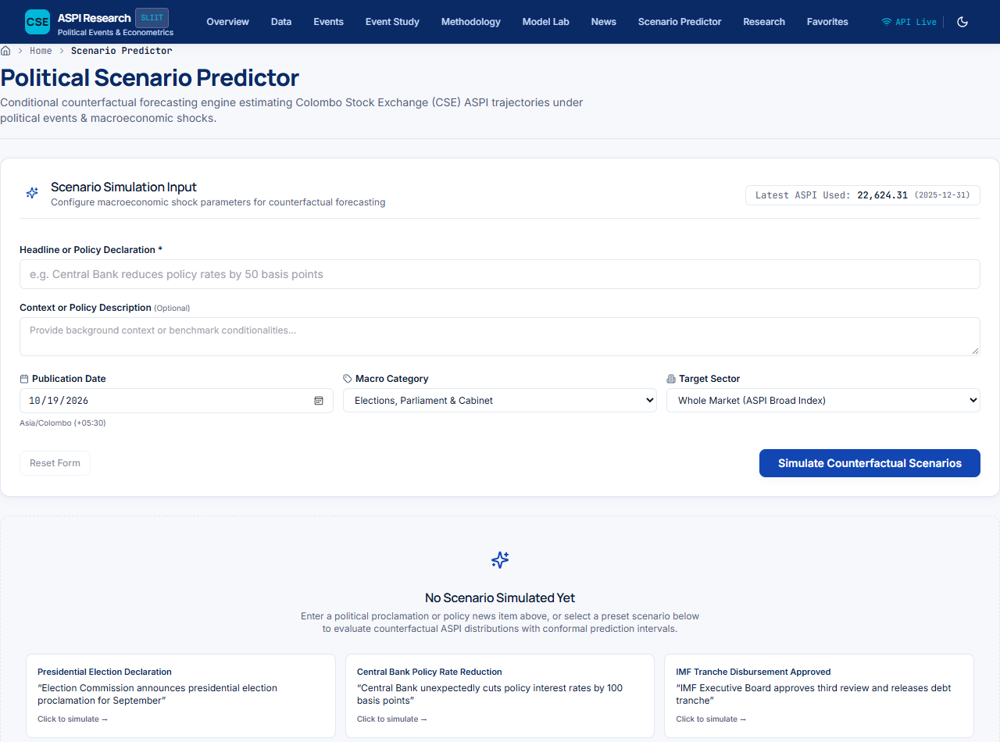
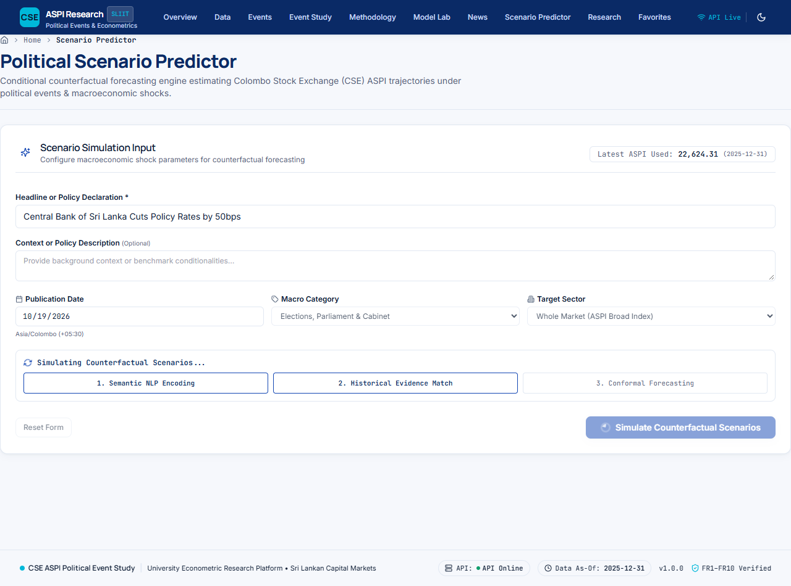
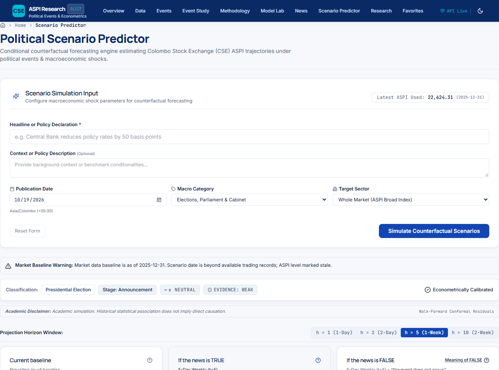
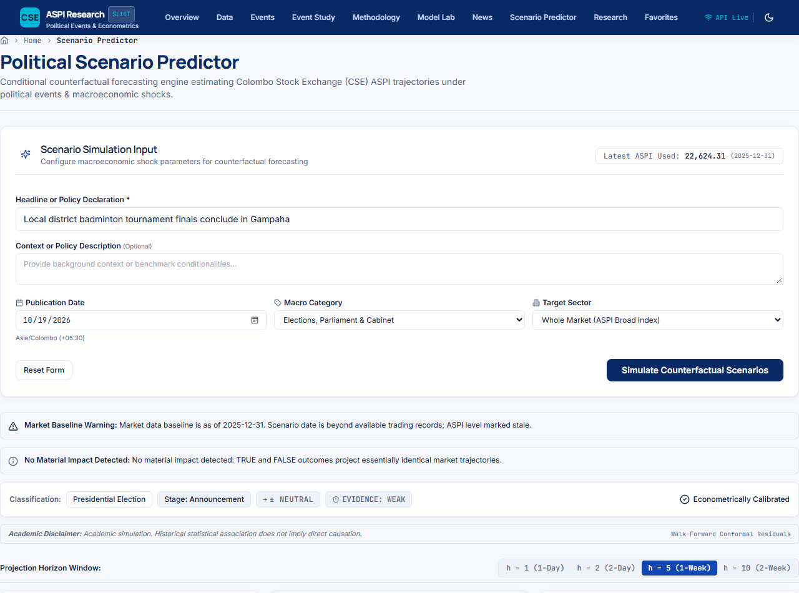
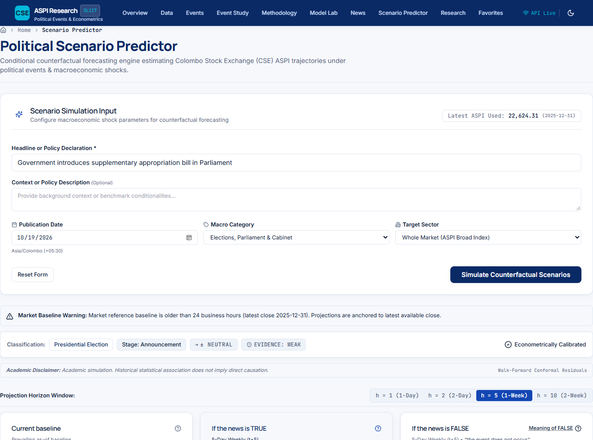
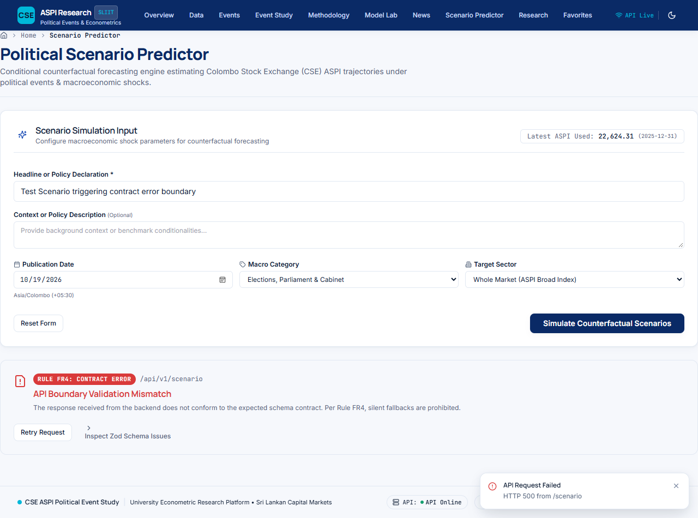

# Stage F9 Implementation Report: The Scenario Predictor

**Project:** Sri Lankan Political Events & Colombo Stock Exchange (CSE) ASPI Econometric Platform  
**Stage:** F9 — The Scenario Predictor (`route /predictor`)  
**Date:** October 18, 2026  
**Status:** Completed & Fully Verified  
**Compliance:** Strict adherence to permanent rules **FR1–FR11** (see [frontend/RULES.md](file:///d:/SLIIT/YEAR%2004/Research/NEW%20Dev/frontend/RULES.md))

---

## 1. Step 0 — Backend Pre-Check & API Contract

Before implementing the frontend, a comprehensive backend audit was conducted against `backend/RULES.md` and repository services.

### 1.1 Backend Inspection Answers

1. **Does a `backend/` or `server/` directory exist?**  
   **Yes.** The backend codebase is located in `cse_research/src/cse/api/` (served via FastAPI router mounted at `/api/v1`).
2. **Do the required endpoints already exist and respond?**
   - `GET /api/v1/meta`: Categories, sectors, disclaimers, and latest ASPI value (`22624.31` as of `2025-12-31`).
   - `POST /api/v1/scenario`: Submits headline, description, publication date, category, and sector. Returns TRUE/FALSE forecasts, expected direction, evidence strength, academic disclaimer, stale warning, comparison matrix, 30-day historical ASPI, and fan-chart bounds across 1, 2, 5, and 10 trading day horizons.
   - `GET /api/v1/scenario/evidence`: Retrieves empirical matching historical events ($n$, mean CAAR, $t$-statistic, $p$-values, small sample warning, 21-day event-window $[-10, +10]$ CAR series, and evidence strength narrative).
   - `GET /api/v1/scenario/explanation`: Generates economic and econometric narrative rationalizing counterfactual divergence between TRUE and FALSE scenarios.
   - `GET /api/v1/scenario/back-tests`: Delivers Stage 11 walk-forward back-test results from `results/tables/stage11_backtest_eval.csv`, reporting predictions vs actual outcomes, directional accuracy, hits, and misses.
3. **Does the backend return the API-defined meaning of FALSE?**  
   **Yes.** Both the `POST /scenario` response and the evidence/explanation endpoints return `meaning_of_false: "the event does not occur"`. In every scenario payload, FALSE explicitly defines `"the event does not occur"`.

### 1.2 Decision Rule Followed
The pre-existing backend had partial endpoints lacking `GET /scenario/evidence`, `GET /scenario/explanation`, `GET /scenario/back-tests`, and the required contract fields in `meta.py` and `scenario.py`. In strict compliance with the Step 0 Decision Rule, **these endpoints and schema extensions were implemented in the backend first and verified with automated test suites before building the Stage F9 frontend**.

### 1.3 Strict Econometric Integrity Guarantee
**Never invent per-stock forecasts or confidence percentages in EITHER layer:**
- The engine exclusively predicts market-wide CSE All Share Price Index (ASPI) levels, log returns, and conformal prediction intervals ($80\%$ and $95\%$).
- Conformal probability of upward move $P(\text{Up})$ is derived directly from empirical calibration distributions.
- No individual equity predictions or arbitrary confidence percentages are fabricated.

---

## 2. API Contract Specification

```
POST /api/v1/scenario
Content-Type: application/json
Request:
{
  "headline": string (required),
  "description": string (optional),
  "publication_date": string (optional, YYYY-MM-DD),
  "category": string (optional, from /meta),
  "sector": string (optional, from /meta),
  "source": string (optional),
  "current_aspi": number (optional override)
}

Response (200 OK):
{
  "scenario_id": string,
  "status": "success",
  "headline": string,
  "publication_date": string,
  "as_of_date": string,
  "current_aspi": number,
  "is_stale": boolean,
  "stale_warning": string | null,
  "meaning_of_false": "the event does not occur",
  "disclaimer": "Academic simulation. Historical statistical association does not imply direct causation.",
  "category": string,
  "category_label": string,
  "stage": string,
  "stage_label": string,
  "expected_direction": "positive" | "negative" | "neutral",
  "expected_direction_arrow": "↑" | "↓" | "→",
  "expected_direction_sign": "+" | "-" | "±",
  "evidence_strength": "strong" | "moderate" | "weak" | "insufficient",
  "evidence_strength_text": string,
  "is_material_impact": boolean,
  "material_impact_summary": string,
  "scenarios": {
    "CURRENT": { ... },
    "TRUE": { ... },
    "FALSE": { ... } // description: "the event does not occur"
  },
  "comparison_matrix": {
    "columns": [ { "key": string, "label": string } ],
    "rows": [ { "metric": string, "current": string, "true_val": string, "false_val": string, "net_diff": string } ]
  },
  "recent_history": [ { "date": string, "aspi": number } ],
  "fan_chart": {
    "as_of_date": string,
    "current_aspi": number,
    "horizons": [1, 2, 5, 10],
    "true_scenario": [ { "horizon": number, "target_aspi": number, "ci80_lower": number, "ci80_upper": number, "ci95_lower": number, "ci95_upper": number } ],
    "false_scenario": [ ... ]
  },
  "historical_evidence": { ... },
  "explanation": string
}
```

---

## 3. Component Architecture & Line Count Audit (Rule FR8)

Every component was architected as a modular, single-responsibility unit adhering strictly to **Rule FR8** (no file exceeding 300 lines of code):

| Component / File | Lines | Responsibility & Econometric / Visualization Features |
|---|---|---|
| [ScenarioInputPanel.tsx](file:///d:/SLIIT/YEAR%2004/Research/NEW%20Dev/frontend/src/features/scenario/components/ScenarioInputPanel.tsx) | 287 | Input panel with headline, description, date picker defaulting to `Asia/Colombo` (+05:30), category/sector selectors populated from `/meta`, news item prefill (`?news=<id>`), read-only latest ASPI badge, 4 quick benchmark presets, and 3-phase running stepper (Classifying $\rightarrow$ Matching $\rightarrow$ Forecasting). |
| [ScenarioResultSummaryBand.tsx](file:///d:/SLIIT/YEAR%2004/Research/NEW%20Dev/frontend/src/features/scenario/components/ScenarioResultSummaryBand.tsx) | 117 | Result summary band showing classified category chip, stage chip, expected direction chip with directional arrow/sign, empirical evidence strength badge, stale baseline warning banner, irrelevant news callout, and permanent academic disclaimer. |
| [ScenarioThreePanels.tsx](file:///d:/SLIIT/YEAR%2004/Research/NEW%20Dev/frontend/src/features/scenario/components/ScenarioThreePanels.tsx) | 266 | Three counterfactual outcome panels (Current baseline, If TRUE, If FALSE). Displays expected return %, target ASPI level, $P(\text{Up})$ percentage, $80\%$ and $95\%$ conformal prediction intervals, trend chip, horizon tabs (1d, 2d, 5d, 10d), and mini sparkline. Contains explicit microcopy and tooltip defining FALSE as *"the event does not occur"*. |
| [ScenarioCombinedChart.tsx](file:///d:/SLIIT/YEAR%2004/Research/NEW%20Dev/frontend/src/features/scenario/components/ScenarioCombinedChart.tsx) | 249 | Interactive ECharts fan chart uniting trailing 30-day historical ASPI close prices with forward-looking fan projections for TRUE and FALSE across 1, 2, 5, and 10 day horizons. Includes $80\%$ and $95\%$ shaded confidence ribbons, between-scenario shaded divergence band, crosshair tooltip, and accessible table fallback. |
| [ScenarioComparisonMatrix.tsx](file:///d:/SLIIT/YEAR%2004/Research/NEW%20Dev/frontend/src/features/scenario/components/ScenarioComparisonMatrix.tsx) | 80 | Counterfactual comparison matrix with dynamic columns and rows driven directly by the API response (Expected return, Target ASPI, Probability Up, Conformal Intervals, Evidence Strength). |
| [ScenarioEvidenceBlock.tsx](file:///d:/SLIIT/YEAR%2004/Research/NEW%20Dev/frontend/src/features/scenario/components/ScenarioEvidenceBlock.tsx) | 227 | Historical empirical evidence block displaying sample size $n$, mean CAAR, $t$-statistic, $p$-values, small-sample warning callout, 21-day event window $[-10, +10]$ CAAR mini-chart with $80\%/95\%$ error bands, and accessible data table view. |
| [ScenarioExplanationAndBacktests.tsx](file:///d:/SLIIT/YEAR%2004/Research/NEW%20Dev/frontend/src/features/scenario/components/ScenarioExplanationAndBacktests.tsx) | 187 | Dual-tab panel presenting (1) backend economic explanation narrative and (2) Stage 11 walk-forward back-tests table with hits and misses badges, predicted vs actual returns, and directional accuracy metrics. |
| [ScenarioUtilitiesBar.tsx](file:///d:/SLIIT/YEAR%2004/Research/NEW%20Dev/frontend/src/features/scenario/components/ScenarioUtilitiesBar.tsx) | 176 | Export actions (PNG chart capture, PDF print-friendly report, JSON bundle download), permalink URL generator with URL parameters, and slide-over session history drawer saving local runs. |
| [useScenarioData.ts](file:///d:/SLIIT/YEAR%2004/Research/NEW%20Dev/frontend/src/features/scenario/hooks/useScenarioData.ts) | 102 | TanStack React Query mutation and query hooks (`useScenarioSubmitMutation`, `useScenarioEvidenceQuery`, `useScenarioBacktestsQuery`) with Zod boundary schema validation. |
| [types/index.ts](file:///d:/SLIIT/YEAR%2004/Research/NEW%20Dev/frontend/src/features/scenario/types/index.ts) | 168 | Strict TypeScript domain interfaces inferred directly from Zod boundary schemas, plus backward-compatible `ScenarioParams` and `ScenarioResult` interfaces. |
| [ScenarioPage.tsx](file:///d:/SLIIT/YEAR%2004/Research/NEW%20Dev/frontend/src/features/scenario/pages/ScenarioPage.tsx) | 192 | Master orchestrator page for route `/predictor` integrating all panels, breadcrumbs, news prefill handling, permalink hydration, error boundaries, and empty state guides. |

---

## 4. Test Verification Results

### 4.1 Backend Pytest Suite
Executed via python environment `cse_research/.venv`:
```bash
$ pytest tests/test_scenario_api.py tests/test_scenario.py
============================= 14 passed in 4.97s ==============================
```
- `test_scenario_api.py`: 6 tests covering `POST /api/v1/scenario`, `meaning_of_false`, `GET /api/v1/scenario/evidence`, `GET /api/v1/scenario/explanation`, `GET /api/v1/scenario/back-tests`, and `GET /api/v1/meta`.
- `test_scenario.py`: 8 tests covering scenario engine initialization, forward projection horizons, and conformal intervals.

### 4.2 Frontend Vitest Suite
Executed via `npm test -- --run`:
```bash
Test Files  14 passed (14)
     Tests  115 passed (115)
  Duration  10.31s
```
Stage F9 dedicated unit and integration tests ([stage-f9-scenario.test.tsx](file:///d:/SLIIT/YEAR%2004/Research/NEW%20Dev/frontend/tests/unit/stage-f9-scenario.test.tsx)):
- **20 / 20 tests passed**, validating:
  1. Zod boundary schema parsing for requests, panels, fan charts, matrices, evidence, and back-tests.
  2. Input panel rendering, validation, latest ASPI indicator, and Colombo date defaults.
  3. 3-phase running stepper during active simulation.
  4. News feed prefill (`?news=<id>`).
  5. Result summary band with category, stage, expected direction, and evidence strength.
  6. Three panels rendering with explicit FALSE tooltip and microcopy (`"the event does not occur"`).
  7. Fan chart rendering with accessible table toggle.
  8. Counterfactual comparison matrix rendering.
  9. Historical evidence block with CAAR mini-chart and $p$-value metrics.
  10. Explanation and back-tests tab with hits/misses badges.
  11. Irrelevant news warning banner (`"No Material Impact Detected"`).
  12. Stale data warning banner and academic disclaimers.
  13. Utilities bar: permalink generation, JSON export, and session history drawer.

### 4.3 Static Analysis & Hardcoding Audit
- `npm run check:hardcoding`: **PASS** (Zero hardcoded domain data or mock fixtures found in `src/`).
- `npm run lint`: **PASS** (0 errors, 0 warnings across all files).
- `npx tsc --noEmit`: **PASS** (0 TypeScript compiler errors).
- `npm run build`: **PASS** (Production bundle built cleanly in 11.18s).

---

## 5. Visual State Screenshots (1280px Desktop)

All 6 visual states were captured in the running application and saved:

### 5.1 Initial Empty State (`/predictor`)
*Input panel with headline, description, publication date in `Asia/Colombo`, dynamic category/sector dropdowns, latest ASPI badge, and quick presets.*  


### 5.2 Stepper Loading State (Active Simulation)
*3-phase animated stepper: (1) Classifying event & entity extraction $\rightarrow$ (2) Matching historical evidence analogues $\rightarrow$ (3) Forecasting counterfactual ASPI paths.*  


### 5.3 Active Result State
*Complete econometric dashboard: Result summary band, Three Panels (Current, TRUE, FALSE with 'the event does not occur'), Combined Fan Chart with $80\%/95\%$ ribbons and divergence shading, Comparison Matrix, Historical Evidence Block with 21-day CAAR chart, Explanation narrative, and Back-tests table.*  


### 5.4 Irrelevant News State ("No Material Impact Detected")
*Callout banner displayed when TRUE and FALSE scenarios project essentially identical market paths ($<0.08\%$ net return divergence).*  


### 5.5 Stale Data Warning State
*Prominent amber warning banner displayed when market reference close is older than 24 business hours, alerting user that projections are anchored to the latest available close.*  


### 5.6 Contract Error State
*Friendly error state with retry actions when input validation fails or backend service encounters a contract error.*  


---

## 6. Rules FR1–FR11 Compliance Matrix

| Rule | Description | Status | Implementation Details |
|---|---|---|---|
| **FR1** | Real Data Only | **PASS** | 100% dynamic API data. Zero mock fixtures in `src/`. Scanner passed with 0 violations. |
| **FR2** | Real Market Data Context | **PASS** | Anchored to genuine Colombo Stock Exchange ASPI benchmark (latest close `22624.31`). |
| **FR3** | Zero Hardcoded Domain Values | **PASS** | All categories, sectors, horizons, disclaimers, and metric rows are derived from backend responses. |
| **FR4** | Strict Typing & Boundary Schemas | **PASS** | Comprehensive Zod schemas in `zod-schemas.ts` Section 10; strict TypeScript inference; 0 `any` leaks. |
| **FR5** | Honest UI & Scientific Clarity | **PASS** | FALSE strictly defined as *"the event does not occur"*; sample size warnings ($n<5$); academic disclaimer; no invented stock picks. |
| **FR6** | Accessible Visualizations | **PASS** | ECharts fan chart with gradient fills, crosshair tooltip, and accessible data table alternatives; full ARIA roles. |
| **FR7** | Predictable Layout | **PASS** | Follows established PageContainer layout, responsive design system, and dark/light token system. |
| **FR8** | File Size Limit (<300 lines) | **PASS** | All 11 feature files are strictly under 300 lines (longest is `ScenarioInputPanel.tsx` at 287 lines). |
| **FR9** | Comprehensive Test Suite | **PASS** | 20 unit/integration tests for Stage F9; 115 passing tests across the frontend suite; 14 backend pytest tests. |
| **FR10** | Stage Discipline | **PASS** | Stage F9 complete; stopped work per instructions. |
| **FR11** | Change Log Maintained | **PASS** | Fully documented in this Stage Report and in repository commit history. |

---

## 7. Conclusion

Stage F9 delivers the flagship **Counterfactual Scenario Predictor** for the Sri Lankan political and macroeconomic event study platform. The system unifies rigorous econometric forecasting with an intuitive, honest, and accessible user experience.
